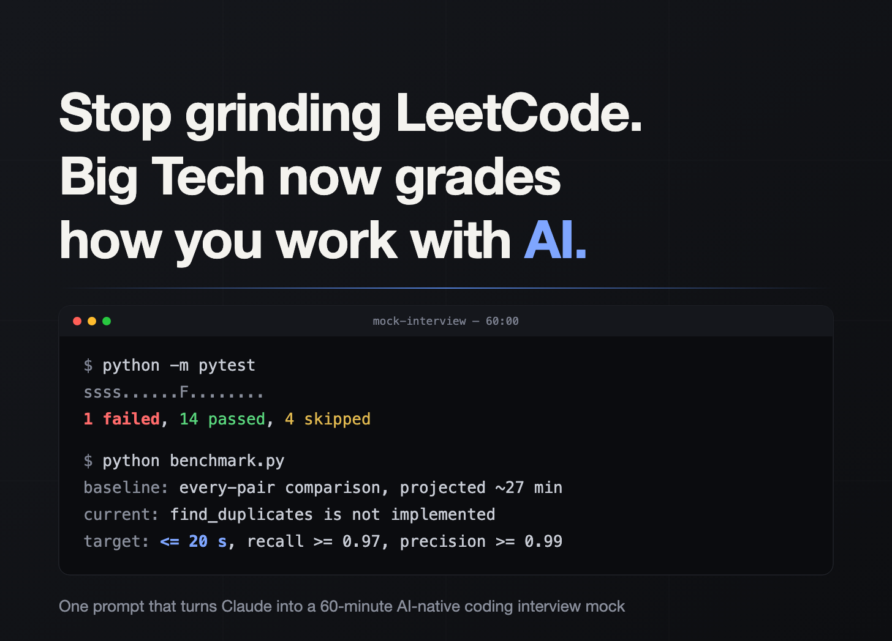

# One-prompt mock interview

**One prompt that turns Claude into a 60-minute AI-native coding interview mock**: a codebase you didn't write, one planted bug, a benchmark to beat, three blocks of rising difficulty, and nothing on disk that gives the answer away.

**Launch it:** https://stylet.github.io/one-prompt-mock-interview/

The page shows the prompt and has buttons that open Claude or ChatGPT with the full text already in the composer. For a coding agent (Claude Code, Codex, Cursor and similar) copy [`prompt.md`](prompt.md) and paste it as the first message in an empty directory.

## What it does

1. Asks for your target company, role, level and language, and nothing else until you answer.
2. Researches that company's current coding round on the web and reports the format facts with sources.
3. Proposes a scenario and a file tree, and waits for one confirmation.
4. Builds the challenge: 100–500 lines of realistic starter code with exactly one planted bug, a small and a large dataset, a test suite with exactly one failing test, a benchmark printing baseline, current and target.
5. Proves every target with at least two reference solutions, then deletes them.
6. Audits the directory for anything that gives the answer away.
7. Runs every command and pastes the output into the handover.

You get `Instruction.md`, the code, the data, the tests and the benchmark. Set a 60-minute timer and start.

## Why

Several large companies now run coding rounds where an AI assistant is available and your use of it is graded. The rated skill is judgment over the model's output, not recall. LeetCode does not train that; this does.

## Contributing

Run it against the company you are preparing for and open an issue where it cheated: what it left on disk, what it hinted at, where the naive approach did not actually break. Pull requests to `prompt.md` welcome. The page reads `prompt.md` at load time, so changes to the prompt ship without touching the HTML.

## License

MIT. Format facts about real interviews come from public sources; nothing here is from inside any company's process.
